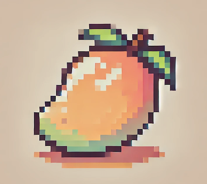
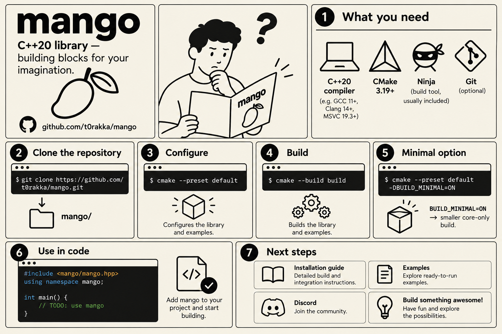
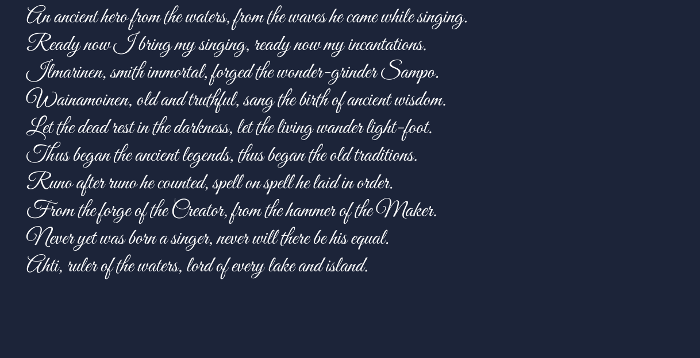

<h2> MANGO - building blocks for your imagination.</h2>


[](https://github.com/t0rakka/mango/actions/workflows/ci.yml)

<br clear="left"/>

---

## What is MANGO?

MANGO is a **C++20 foundation framework** — platform abstraction and shared infrastructure. We don't prescribe your architecture; we supply **interlocking building blocks** so you can build something bigger. Your design, your rules — we just make the boring parts solid so coding the interesting parts is left to you, or just use functionality you need like encoding and decoding images.

The services are the kind you reach for in every real project: **filesystem abstraction** (`game.zip/levels/…` opens like a folder), a **unified compression API** (including streaming), **image decoding and encoding** with **color management**, plus **vector math** and a modern **SIMD** layer that stays friendly to hand-tuned intrinsics. Need windows, GL/Vulkan helpers, or mesh import? Those are **optional modules** on the same foundations — enable them in CMake and they slot in without a second ecosystem.

**Customize the build** to match the job. Run the full stack or a tight subset: `BUILD_MINIMAL`, turn off Vulkan, pick only the `IMAGE_FORMAT_*` codecs you need. HEIC, camera RAW, and friends are deliberately optional — their dependencies are heavy. A desktop image viewer might enable everything; an engine texture path might stay on PNG, JPEG, and KTX2. If a library isn't installed, configure skips that format and keeps going. Details: [installation guide](docs/installation/setup.md).

---

## Quick start



```bash
git clone https://github.com/t0rakka/mango.git
cd mango
cmake --preset default
cmake --build build
```

```cpp
#include <mango/mango.hpp>
using namespace mango;
using namespace mango::image;

int main()
{
    Bitmap texture("archive.zip/textures/albedo.png");
    // ...
}
```

---

## Features

*The quick start gets you compiling — here is what the library is for in practice.*

### Filesystem

Containers look like directories. `Path` keeps container indexes alive so reading many small files stays cheap.

```cpp
Path path("data.zip/");
File file(path, "images/test.png");
```

ZIP, RAR, 7z, ISO, custom HBS, nested archives → [filesystem examples](docs/examples/filesystem.md).

Those paths are not toy parsers: decompressors are **optimized aggressively**, and **CI re-opens real archives on every check-in** — many ZIP storages (deflate, deflate64, bzip2, LZMA, PPMd, classic and AES crypto), 7z/LZMA2, solid and password-protected RAR, encrypted HBS — with **checksums verified** against known-good payloads so regressions surface immediately.

### Images


Inspect headers, decode to flexible `Format` layouts, async decode, block compression, ICC, and optional GPU-oriented KTX2 / Basis transcode paths.

**<mark>NEW!</mark>** MANGO now decodes **<mark>HDR PNG</mark>** (PNG 3rd edition signalling: `cICP`, `mDCV`, `cLLI`, 16-bit linear) and **<mark>UltraHDR JPEG</mark>** (ISO 21496-1 / Adobe `hdrgm` gain-map JPEG) — scene-linear fp16 output with HDR metadata preserved.

Benchmarks and format notes → [mango::image](docs/examples/image.md#library-comparisons).

### Math & SIMD

**C++20 Math** is a concept-driven short-vector layer for the work you do in 3D: matrices, quaternions, cameras, and the usual geometry helpers — with component accessors and swizzles (`a.xyyz + b.xywz`) so vector work stays expressive in plain C++20. Integer, unsigned, and floating-point lanes are all first-class, not an afterthought. Underneath, the **SIMD** machinery maps those types onto NEON, SSE, AVX, and the rest: one portable surface, a direct path to intrinsics when a hot loop needs it.

### Compression & encryption

One **unified compression interface** across deflate, zstd, lz4, and the other codecs mango supports — swap the scheme without rewriting your pipeline; buffers and **streaming** use the same patterns, and the usual foot-guns (undersized output buffers, size checks, codec-specific edge cases) are handled for you. **Checksums and hashes** (CRC32, Adler32, MD5, SHA family, …) use the same philosophy: tuned implementations, validated in tests whenever code lands. Encryption follows the same idea: a single surface with AES-NI / ARM Crypto where the CPU provides it.

### Vulkan — glyph rendering *(optional module)*



With `BUILD_VULKAN` enabled, **mango::vulkan::FontRenderer** is finely tuned machinery for GPU text: vector outlines, realtime scaling, hinting modes, and OpenType ligatures — not a bolt-on font texture atlas. Run the Vulkan **font** example to see it in action.

---


[Installation](docs/installation/setup.md) · [Examples](docs/examples/examples.md) · [Discord](https://discord.gg/E2xuXbK9Kf)
